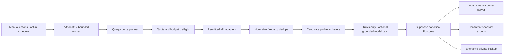

# Implemented architecture

`config.py` is deny-by-default. No module import performs network I/O. `Store` creates SQLite only for explicitly selected demo/test mode. Production uses owner-filtered Supabase REST requests with a trusted server secret, never an automatic local fallback. The URL is checked against the dedicated project reference. All 21 tables use owner scoping, primary/unique keys, UTC timestamps, foreign keys and composite owner foreign keys.

Migrations revoke public/anon/authenticated access, enable and force RLS, and grant only the trusted service role. No browser session can access tables directly. Atomic budget and lease functions are SECURITY INVOKER, with public EXECUTE revoked. The service key bypasses RLS by design and must be held only by the trusted local owner server and GitHub Secrets. This is a single-owner application, not a public multi-tenant service; owner UUIDs are namespaces, not authentication claims.

The 21 tables cover provider registry/quotas, query plans, runs, observations, clusters and memberships, opportunities and claim-level evidence, competitors/prices, spending, current/historical scores, queue, validation, owner feedback, usage/budgets, alerts and leases. Durable state never relies on an ephemeral runner disk. `oi_snapshot` reads the owner namespace in one SQL statement so exports/backups do not mix table snapshots. SQLite uses an explicit transaction for the equivalent offline operation.

Source content is sanitized to short excerpts, attributed, timestamped and retained with original/normalized URLs and replay hashes. Exact IDs, URLs and content hashes are unique; near-copy text is deduplicated. Different documents are not automatically counted as different customers. Known author hashes contribute only to tentative recurrence, not buyer validation. Candidate clusters retain root-cause uncertainty. Manual owner feedback is distinct from public source facts.

Claim types are source_fact, inference, hypothesis and owner_feedback. The LLM receives JSON-encoded untrusted source data in a user message, has no tools, and cannot change the system policy. Pydantic validation rejects extra fields, invented observation IDs and non-matching quotes. Claims are always attached to original evidence. Critique adds weaknesses/counterevidence and queues targeted research instead of deleting ideas. Rules-only analysis remains clearly labelled when no authorized model succeeds.

Digital ranking uses severity 20, spending 20, recurrence 15, underserved gap 15, distribution 15, feasibility 10 and momentum 5. Only assessed dimensions enter the normalized score; coverage records the sum of represented weights. For example, one assessed dimension can produce a high score with low coverage; it is never a probability. Novelty, upside, confidence and effort stay separate. Physical candidates never enter this digital ranking.

Each external request reserves worst-case cost and source quota before access. Budget reservations and settlement are database-atomic in production; unknown charges retain the reservation. Unknown price/headroom, paid-disabled mode and open circuits refuse requests. Current catalogs are required before exact model IDs are accepted. No premium model per document: preprocessing is deterministic and model input/output batches are bounded.

The planner rotates industry, role, workflow, geography, language and research approach. It roughly allocates capacity to measured yield, new combinations and counterevidence; small batches round this allocation. Per-source cursors avoid advancing failed sources, a six-hour query cache avoids repetitive calls, and source IDs/content hashes avoid repeated pages. The first catch-up window is bounded to seven days. The global database lease and shared GitHub concurrency group serialize workers.

Exports use one snapshot for XLSX, CSV and Markdown. OOXML is written with the Python standard library: real sheets, filters, frozen headings, styled headers and source hyperlinks; formula-like text is escaped. No secret configuration is included. Backups encrypt a compressed, checksummed snapshot with a separately stored Fernet key. Restore validates schema and owner and defaults to dry-run. See RUNBOOK for production validation boundaries.
